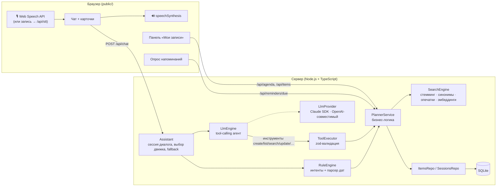

# 🎙️ Голосовой ежедневник

Прототип голосового ассистента, который ведёт личные **задачи, напоминания и встречи** на естественном русском языке — голосом или текстом.

> **Демо:** https://voice-planner-production-1a6c.up.railway.app  ·  **Репозиторий:** https://github.com/maingraph/voice-planner

```
голос → распознавание речи → понимание запроса → действие с данными → ответ текстом и голосом
```

| Обязательные сценарии | Статус |
|---|---|
| Создание задачи / напоминания («Напомни мне завтра в 10 утра позвонить Ивану») | ✅ |
| Создание встречи («В четверг в 11 у меня встреча с дизайнером») | ✅ |
| Список дел за период («Что у меня сегодня?», «Что запланировано на эту неделю?») | ✅ |
| Поиск старых записей по смыслу («Я когда-то ставил задачу по договору, найди её») | ✅ |
| Данные сохраняются между запросами (SQLite) | ✅ |

| Дополнительно (из списка «будет плюсом») | Статус |
|---|---|
| Изменение и удаление голосом, отмена удаления («верни») | ✅ |
| Отметка выполненной («Я сделал отчёт», «Отметь задачу про отчёт выполненной») | ✅ |
| Конфликты встреч: предупреждение и выбор — «всё равно добавить» или другое время | ✅ |
| Повторяющиеся задачи и встречи («по будням в 9:30», «каждый понедельник») | ✅ |
| Контекст диалога («А перенеси её на завтра», «сдвинь на час позже») | ✅ |
| Семантический поиск: морфология + синонимы + опечатки, опционально эмбеддинги | ✅ |
| Интеграция с реальным календарём: iCal-подписка для Google / Apple / Outlook | ✅ |
| Несколько пользователей (анонимный id в браузере, данные изолированы) | ✅ |
| Неоднозначные запросы и уточняющий диалог («На какое время поставить встречу?», «Какую удалить: первую или вторую?») | ✅ |
| Напоминания реально срабатывают: уведомление + озвучка в браузере | ✅ |

---

## Быстрый старт

Нужен **Node.js 20+**.

```bash
npm install
```

```bash
npm run dev
```

Откройте http://localhost:3000 в **Chrome, Edge или Safari** (у них встроенное распознавание речи), нажмите на микрофон и говорите. Можно и печатать.

**Ключи не обязательны.** Без ключа LLM ассистент работает на встроенном движке разбора русского языка — все обязательные сценарии работают офлайн. Чтобы включить LLM, скопируйте `.env.example` в `.env` и задайте один ключ:

```bash
cp .env.example .env
```

| Переменная | Что включает |
|---|---|
| `ANTHROPIC_API_KEY` | Понимание запросов через Claude (по умолчанию `claude-opus-5-5`, `LLM_EFFORT=low` ради скорости голосового ответа) |
| `LLM_API_KEY` + `LLM_BASE_URL` + `LLM_MODEL` | Любой OpenAI-совместимый провайдер: OpenAI, OpenRouter, Groq, YandexGPT, локальная Ollama |
| `EMBEDDINGS_API_KEY` | Векторный семантический поиск поверх лексического |
| `STT_API_KEY` | Серверное распознавание речи (Whisper) для браузеров без Web Speech API, например Firefox |

Проверки:

```bash
npm test
```

```bash
npm run eval
```

`npm test` — 145 автотестов (сценарии из ТЗ, парсер дат, поиск, повторения, цикл LLM-агента со «сценарной» моделью, HTTP API). `npm run eval` прогоняет 14 диалогов из ТЗ через **текущий** движок (LLM, если задан ключ) и проверяет сохранённые данные — удобно сравнивать модели.

Docker:

```bash
docker build -t voice-planner .
```

```bash
docker run -p 3000:3000 -v planner-data:/data --env-file .env voice-planner
```

---

## Архитектура



Слои разделены так, как просит ТЗ — голос, LLM, бизнес-логика и хранение независимы:

| Слой | Где | Ответственность |
|---|---|---|
| **Голос** | `public/app.js`, `src/voice/stt.ts` | Распознавание (Web Speech API в браузере; серверный Whisper как запасной вариант), синтез речи, «hands-free»: если ассистент задал уточняющий вопрос на голосовой запрос, микрофон включается сам |
| **Понимание** | `src/agent/*`, `src/nlu/*`, `src/llm/*` | Два взаимозаменяемых движка за одним интерфейсом `DialogueEngine`. LLM получает инструменты и сам решает, что вызвать; правила — детерминированный разбор русского. Если LLM недоступна, запрос обрабатывают правила |
| **Бизнес-логика** | `src/domain/planner-service.ts` | Валидация (у встречи обязано быть время), конфликты, повторения, выполнение, уведомления. Ничего не знает про HTTP и LLM — оба движка вызывают одни и те же методы |
| **Поиск** | `src/search/*` | Гибридный поиск по смыслу |
| **Хранение** | `src/storage/*` | SQLite (`better-sqlite3`), миграции через `user_version` |
| **HTTP** | `src/http/routes.ts` | Fastify, тонкие обработчики, zod-валидация входа |

### Как ассистент понимает запрос

**Режим LLM (основной при наличии ключа).** `LlmEngine` отправляет модели системный промпт с правилами, текущим временем, **таблицей календаря** на −7…+14 дней («2026-11-06 пятница») и списком недавно обсуждавшихся записей с id. Модель вызывает инструменты `create_item`, `list_items`, `search_items`, `update_item`, `complete_item`, `delete_item`, `restore_last_deleted`. Важные правила проверяет **сервер**, а не только промпт:

- встреча без времени → инструмент вернёт `needs_info` с готовым вопросом «На какое время поставить встречу?»;
- пересечение встреч → `conflict`, сохранить можно только с явным `allow_conflict` после подтверждения пользователя;
- неверные аргументы → ошибка zod-валидации уходит модели, и она исправляет вызов;
- если модель упала **после** изменения данных, запрос не повторяется правилами (иначе задвоили бы запись), а пользователь получает сводку выполненного.

Контекст «её/его» работает так: в каждой реплике ассистент запоминает, о каких записях шла речь, и следующий промпт их перечисляет. История между репликами передаётся как обычный текст, поэтому промпт можно пересобирать на каждый запрос (свежее время), не ломая сохранённые блоки рассуждений модели.

**Офлайн-режим (правила).** `RuleEngine` — без внешних сервисов:

1. `intents.ts` определяет действие по формулировке: «Что у меня сегодня?», «Какие планы на сегодня?», «Покажи мои встречи на сегодня» → одно и то же `list`.
2. `date-parser.ts` разбирает русские даты и время: сегодня/завтра/послезавтра, дни недели («в следующий вторник»), «через два часа», «через полчаса», «на следующей неделе», «в выходные», «до конца недели», «15 ноября», «15.11», «25-го числа», «в 3 дня», «в половине третьего», «в час дня», «с 14 до 15:30», «на полтора часа», «по будням», «каждый понедельник». Разобранные фрагменты вырезаются — остаток становится названием («Напомни мне завтра в 10 утра позвонить Ивану» → «Позвонить Ивану»).
3. Недостающие данные → уточняющий вопрос с сохранением черновика в сессии. Ответ «в 16», «давай в 17», «вечером» дополняет черновик; новая команда вместо ответа — отменяет его.

### Поиск по старым записям

`SearchEngine` ищет по всем записям пользователя (прошлым и будущим, выполненным и нет):

- **морфология** — стемминг Snowball: «Иваном» находит «Встреча с Иваном», «презентации» — «презентацию»;
- **синонимы** — небольшой тезаурус предметной области: «договор» ↔ «контракт», «созвон» ↔ «встреча» ↔ «совещание», «слайды» ↔ «презентация»;
- **опечатки** — сходство по триграммам: «презентацыя» → «презентация»;
- **LLM-расширение** — в режиме LLM модель передаёт `related_terms` (синонимы и близкие понятия), они учитываются с меньшим весом;
- **эмбеддинги (опционально)** — при `EMBEDDINGS_API_KEY` записи векторизуются при сохранении, итоговый результат — лучший из лексического и векторного.

### Данные

Таблица `items`: `type` (task / meeting / reminder), `title`, `notes`, `start_at` / `end_at` (UTC), `all_day` (известна только дата), `timezone` (пояс создания — чтобы «пятница» оставалась пятницей в любом поясе), `status` (pending / done), `recurrence` (JSON: частота, интервал, дни недели, до какой даты), `created_at`, `updated_at`, `completed_at`, `last_notified_at`, `source_text` (исходная фраза), `embedding`. Таблица `sessions` хранит историю диалога, черновик уточнения, недавние записи и последнюю удалённую (для «верни»).

---

## Выбор технологий

| Что | Выбор | Почему |
|---|---|---|
| Язык / сервер | TypeScript, Node.js, Fastify | Одна кодовая база с фронтендом, строгая типизация, быстрый старт |
| LLM | Claude (`@anthropic-ai/sdk`) + адаптер под любой OpenAI-совместимый API | Надёжный tool calling на русском; адаптер позволяет запустить на OpenRouter / YandexGPT / Ollama без изменения кода. Для Claude включён серверный `fallbacks: "default"` на случай отказа модели |
| Распознавание речи | Web Speech API (`ru-RU`) | Бесплатно, без ключей, промежуточные результаты видны во время речи. Для Firefox — запись и Whisper на сервере |
| Синтез речи | `speechSynthesis` браузера | Без задержки на сеть, выбирается лучший доступный русский голос |
| БД | SQLite (`better-sqlite3`) | Ноль настройки, транзакции, один файл на volume. Доступ через репозитории — заменить на Postgres легко |
| Даты | Luxon | Часовые пояса и календарная арифметика без сюрпризов с переходом времени |
| Валидация | zod | Одна схема → и проверка аргументов инструментов, и JSON Schema для LLM |
| Фронтенд | HTML + CSS + JS без сборки | В ТЗ акцент на логике; меньше движущихся частей, мгновенная загрузка |
| Тесты | Vitest | Быстро, нативно с TypeScript и ESM |

---

## Решения, принятые самостоятельно

- **Два движка понимания.** LLM даёт гибкость формулировок, правила — работу без ключей, мгновенный ответ и страховку при сбое API. Обязательные сценарии работают в обоих режимах, это закреплено тестами и `npm run eval`.
- **Жёсткие правила на сервере, а не только в промпте**: время встречи, конфликты, формат дат. Модель может ошибиться — данные нет.
- **Модель не считает даты в уме вслепую** — ей дана таблица календаря, а аргументы — локальные `YYYY-MM-DD` и `HH:MM`, которые сервер переводит в нужный пояс.
- **Разделение типов:** «напомни…» → напоминание, встреча/созвон/приём → встреча (по умолчанию 1 час), остальное → задача. Задача может быть без даты, напоминание и встреча — нет.
- **«В 3» = 15:00.** Час 1–7 без уточнения считается дневным/вечерним — так говорят про встречи. Время, которое сегодня уже прошло, переносится на завтра, и ассистент об этом говорит.
- **«До конца недели», «на следующей неделе»** для задачи → срок в последний день периода.
- **Удаление без подтверждения, но с отменой.** Голосом переспрашивать раздражает; вместо этого «Если это ошибка, скажите «верни»». Подтверждение нужно только при неоднозначности («Нашёл несколько… какую удалить?»).
- **Выполнение повторяющейся задачи** переносит её на следующее повторение, а не закрывает серию.
- **Анонимные пользователи.** Браузер хранит случайный id; без регистрации, но данные разных людей изолированы.
- **Календарная интеграция через iCal-подписку**, а не OAuth: работает с любым календарём и не требует хранить чужие токены.

## Что улучшил бы при наличии времени

- **Авторизация** (OAuth / magic link) вместо анонимного id и двусторонняя синхронизация с Google Calendar.
- **Потоковый голос**: стриминговое STT/TTS (например, SpeechKit или Whisper streaming + нейросетевой TTS), ответ начинает звучать до окончания генерации; wake-word.
- **Серверные push-уведомления** (Web Push / Telegram-бот), чтобы напоминания приходили при закрытой вкладке.
- **Хранение и поиск в масштабе**: Postgres + `pgvector` + полнотекстовый индекс вместо перебора записей пользователя.
- **Больше логики планирования**: поиск свободного окна («найди время на час в четверг»), длительность и место встречи, участники, приоритеты, подзадачи.
- **Оценка качества LLM**: расширить `npm run eval` до сотен фраз из реальных логов, сравнивать модели и промпты по метрикам; кэширование промпта для снижения задержки и стоимости.
- **Наблюдаемость**: трассировка вызовов инструментов, метрики задержки по этапам голосового конвейера.

---

## Структура проекта

```
src/
  server.ts              запуск HTTP-сервера
  app.ts                 сборка зависимостей (composition root)
  config/config.ts       переменные окружения
  http/routes.ts         REST API
  agent/                 Assistant (оркестратор), LlmEngine, инструменты, промпт
  llm/                   провайдеры: Claude SDK, OpenAI-совместимый
  nlu/                   офлайн-движок: интенты, парсер дат, числительные
  domain/                PlannerService, повторения, форматирование, iCal
  search/                стемминг, синонимы, гибридный поиск, эмбеддинги
  storage/               SQLite: схема, репозитории
  voice/stt.ts           серверное распознавание речи (опционально)
public/                  веб-интерфейс (HTML/CSS/JS без сборки)
tests/                   автотесты (Vitest)
scripts/eval.ts          прогон сценариев ТЗ через текущий движок
```

## API

| Метод | Путь | Назначение |
|---|---|---|
| `POST` | `/api/chat` | `{ text }` → `{ reply, actions, awaiting, engine }` |
| `GET` | `/api/agenda?view=upcoming\|today\|week\|all` | Записи для боковой панели |
| `POST` | `/api/items/:id/complete` | `{ done }` |
| `DELETE` | `/api/items/:id` | Удаление |
| `GET` | `/api/reminders/due` | Сработавшие напоминания (каждое отдаётся один раз) |
| `GET` | `/api/history` · `POST /api/session/reset` | История диалога / сброс |
| `POST` | `/api/stt` | Аудио → текст (если настроен `STT_API_KEY`) |
| `GET` | `/calendar/<id>.ics` | iCal-подписка |
| `GET` | `/api/health` | Режим работы и доступные возможности |

Все запросы `/api/*` (кроме health) требуют заголовок `X-User-Id`; `X-Timezone` — IANA-пояс пользователя.
